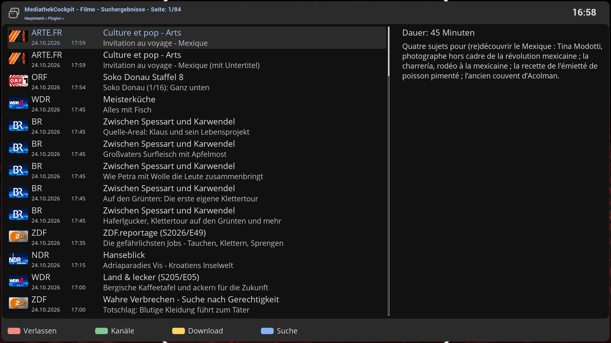

# MediathekCockpit (MTC)

MediathekCockpit lets you search the German-language public broadcasters' Mediatheken (ARD, ZDF, 3sat, ARTE, KiKA,
the regional ARD stations, ORF, SRF and more) from your set-top box. You can **watch** a programme at once, with the full
control of a recording (pause, skip, resume), or **download** it as a file that then sits in your movie directory like
any recording.

This wiki describes version **0.15.1**.

## What it does

- **Search the Mediatheken** by title or topic, by channel, or straight from the EPG of the programme you are watching.
  See [Searching](Searching.md).
- **Play with recording-style control.** Pause, skip forward and back, and resume like with a recording, even though the
  programme is a stream. See [Playback](Playback.md).
- **Download** programmes, several at a time, with cover, description and channel, so they appear in MovieCockpit
  with a cover and a channel logo. See [Downloads](Downloads.md).
- **Filter the noise.** Hide audio-described versions, trailers, sign-language versions and very short clips.
- **Hook into other plugins.** MovieCockpit's info screen and the EPG info of Enigma2 can open MediathekCockpit with
  the programme's title already searched. See [Integration](Integration.md).

The programme data comes from the public **MediathekViewWeb** service (mediathekviewweb.de), which collects the
listings of the Mediatheken. MediathekCockpit has no catalogue of its own. The box needs an Internet connection.

## Pages

| Page | For | Content |
|---|---|---|
| [Installation](Installation.md) | everyone | Requirements, installing, where it appears |
| [User Guide](User-Guide.md) | everyone | The screen, the list, paging, information screens |
| [Keys and Buttons](Keys-and-Buttons.md) | everyone | Every key |
| [Searching](Searching.md) | everyone | Text search, channels, filters, what the entries show |
| [Playback](Playback.md) | everyone | How watching works and what happens to the temporary file |
| [Downloads](Downloads.md) | everyone | Quality, file names, what is saved, the download manager |
| [Settings](Settings.md) | everyone | Every setting |
| [Channels and Logos](Channels-and-Logos.md) | everyone | Channel logos, channel mapping for MovieCockpit |
| [Integration](Integration.md) | everyone | How MovieCockpit and the EPG open it |
| [Troubleshooting](Troubleshooting.md) | everyone | Problems, logging, limitations |
| [Architecture](Architecture.md) | developers | Files, data flow, row layout, skin |

## Related plugins

| Plugin | Relation |
|---|---|
| JobCockpit (JOC) | Runs and shows the downloads (job manager id `MTC`) and the temporary playback download (`TMP`) |
| CacheCockpit (CAC) | Newly downloaded files are added to MovieCockpit's cache |
| MovieCockpit (MVC) | Shows the downloaded files; offers a "Mediathek Download" button |
| ComponentsCockpit, FontCockpit | Skin components and fonts |

## Licence

GNU General Public License v3.0 or later. Copyright 2018-2026 by xcentaurix.
